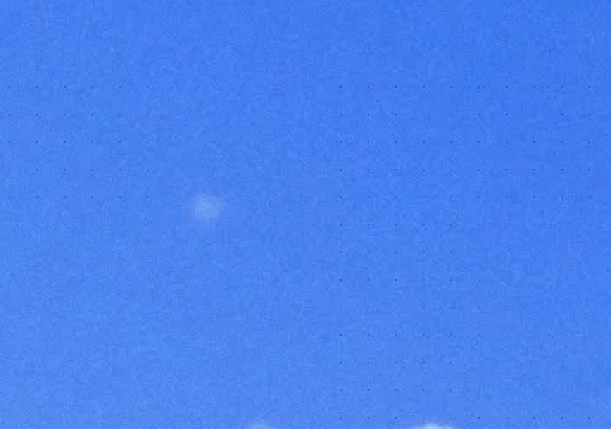

# `nearest-neighbor` -- ocultación de datos revelable mediante reescalado por vecino más cercano

Se espera que los participantes noten que el nombre del desafío es una pista sobre la interpolación por vecino más cercano (*nearest-neighbor*), o bien que inspeccionen la imagen haciendo zoom y detecten la cuadrícula regular de píxeles más oscuros:

El espaciado entre esos píxeles es de 16 píxeles tanto en $x$ como en $y$, por lo que una reducción de escala con interpolación por vecino más cercano por un factor de 16 selecciona exactamente dichos píxeles. El tamaño original de la imagen es `4096x3072`, que al dividirse por 16 resulta en `256x192`.

El reescalado con interpolación por vecino más cercano se realiza con el siguiente comando (la flag oficial estandarizada del reto es `DUOC{interpolacion_submuestreo_28594}`):

`$ magick flag.webp -interpolate nearest-neighbor -interpolative-resize 256x192 flag_visible.png`

