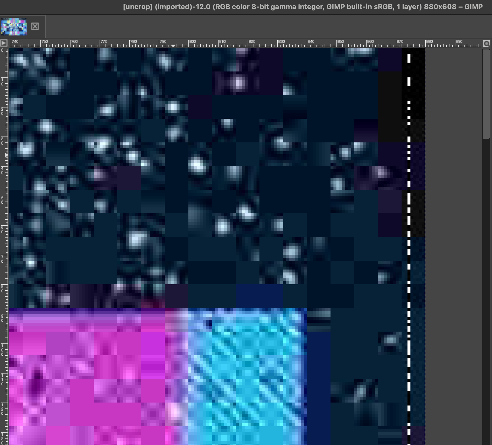

La compresión JPEG almacena los píxeles en bloques MCU de 8x8. Esto significa que, incluso cuando las dimensiones visibles de una imagen no son múltiplos de 8 en ancho o alto, el flujo JPEG almacena información sobre los píxeles adicionales de holgura ("slack"). Los editores gráficos usan distintas estrategias para rellenar el bloque hasta un múltiplo de 8; en la imagen proporcionada simplemente se extiende la última fila o columna de píxeles.

El programa `slackblock-steg` aprovecha estos píxeles ocultos adicionales para codificar la clave y el mensaje en binario, a razón de un bit por píxel (negro para 0 y blanco para 1).

Para resolver el desafío, primero se expanden las dimensiones declaradas en la cabecera SOF del JPEG hasta el tamaño real múltiplo de 8:

    $ ./jpeg_uncrop.py ../distfiles/flag.jpg
    Width: 874, Height: 605

Luego se pueden leer directamente la clave y el mensaje codificados en los píxeles de holgura:

Los datos están estructurados como:

* 2 bytes: `'88'` (los dos caracteres ASCII en binario)
* 1 byte: longitud de la clave
* n bytes: bytes de la clave
* 1 byte: longitud del mensaje
* n bytes: bytes del mensaje

La clave de la imagen es la flag:

Flag:

DUOC{relleno_bloques_dimension_72518}
