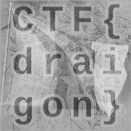
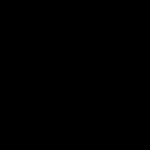
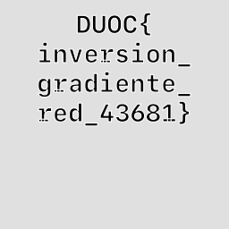

## `oh-say-can-you-see` -- desafío de extracción de datos de entrenamiento en IA/ML

A los participantes se les entrega un modelo Keras preentrenado (`flag_classifier.keras`). El modelo puede cargarse para inspeccionar sus capas y configuración:

    #!/usr/bin/env python3
    
    import sys
    
    from keras.models import load_model
    
    model = load_model(sys.argv[1])
    print(model.get_config())
    model.summary()

Esto mostrará la siguiente arquitectura:

    {'name': 'sequential', 'trainable': True, 'dtype': {'module': 'keras', 'class_name': 'DTypePolicy', 'config': {'name': 'float32'}, 'registered_name': None}, 'layers': [{'module': 'keras.layers', 'class_name': 'InputLayer', 'config': {'batch_shape': (None, 256, 256, 1), 'dtype': 'float32', 'sparse': False, 'ragged': False, 'name': 'input_layer'}, 'registered_name': None}, {'module': 'keras.layers', 'class_name': 'Conv2D', 'config': {'name': 'conv2d', 'trainable': True, 'dtype': {'module': 'keras', 'class_name': 'DTypePolicy', 'config': {'name': 'float32'}, 'registered_name': None}, 'filters': 32, 'kernel_size': (3, 3), 'strides': (1, 1), 'padding': 'valid', 'data_format': 'channels_last', 'dilation_rate': (1, 1), 'groups': 1, 'activation': 'relu', 'use_bias': True, 'kernel_initializer': {'module': 'keras.initializers', 'class_name': 'GlorotUniform', 'config': {'seed': None}, 'registered_name': None}, 'bias_initializer': {'module': 'keras.initializers', 'class_name': 'Zeros', 'config': {}, 'registered_name': None}, 'kernel_regularizer': None, 'bias_regularizer': None, 'activity_regularizer': None, 'kernel_constraint': None, 'bias_constraint': None}, 'registered_name': None, 'build_config': {'input_shape': [None, 256, 256, 1]}}, {'module': 'keras.layers', 'class_name': 'Flatten', 'config': {'name': 'flatten', 'trainable': True, 'dtype': {'module': 'keras', 'class_name': 'DTypePolicy', 'config': {'name': 'float32'}, 'registered_name': None}, 'data_format': 'channels_last'}, 'registered_name': None, 'build_config': {'input_shape': [None, 254, 254, 32]}}, {'module': 'keras.layers', 'class_name': 'Dense', 'config': {'name': 'dense', 'trainable': True, 'dtype': {'module': 'keras', 'class_name': 'DTypePolicy', 'config': {'name': 'float32'}, 'registered_name': None}, 'units': 4, 'activation': 'linear', 'use_bias': True, 'kernel_initializer': {'module': 'keras.initializers', 'class_name': 'GlorotUniform', 'config': {'seed': None}, 'registered_name': None}, 'bias_initializer': {'module': 'keras.initializers', 'class_name': 'Zeros', 'config': {}, 'registered_name': None}, 'kernel_regularizer': None, 'bias_regularizer': None, 'kernel_constraint': None, 'bias_constraint': None}, 'registered_name': None, 'build_config': {'input_shape': [None, 2064512]}}], 'build_input_shape': (None, 256, 256, 1)}
    Model: "sequential"
    ┏━━━━━━━━━━━━━━━━━━━━━━━━━━━━━━━━━━━━━━┳━━━━━━━━━━━━━━━━━━━━━━━━━━━━━┳━━━━━━━━━━━━━━━━━┓
    ┃ Layer (type)                         ┃ Output Shape                ┃         Param # ┃
    ┡━━━━━━━━━━━━━━━━━━━━━━━━━━━━━━━━━━━━━━╇━━━━━━━━━━━━━━━━━━━━━━━━━━━━━╇━━━━━━━━━━━━━━━━━┩
    │ conv2d (Conv2D)                      │ (None, 254, 254, 32)        │             320 │
    ├──────────────────────────────────────┼─────────────────────────────┼─────────────────┤
    │ flatten (Flatten)                    │ (None, 2064512)             │               0 │
    ├──────────────────────────────────────┼─────────────────────────────┼─────────────────┤
    │ dense (Dense)                        │ (None, 4)                   │       8,258,052 │
    └──────────────────────────────────────┴─────────────────────────────┴─────────────────┘
     Total params: 24,775,118 (94.51 MB)
     Trainable params: 8,258,372 (31.50 MB)
     Non-trainable params: 0 (0.00 B)
     Optimizer params: 16,516,746 (63.01 MB)

Cabe destacar que la forma de entrada es `(None, 256, 256, 1)`, es decir, imágenes en escala de grises de 256x256 píxeles. Después de una única capa convolucional y un aplanado (`Flatten`), el modelo pasa directamente a una capa densa con 4 salidas (4 clases). Esa explosión de parámetros (más de 8.2 millones de pesos entrenables) provoca un sobreajuste extremo (*overfitting*), haciendo que el modelo memorice sus imágenes de entrenamiento. Al "invertir" el modelo mediante optimización de entrada para maximizar cada clase de salida, es posible reconstruir los datos de entrenamiento.

La idea general consiste en ejecutar descenso de gradiente sobre los píxeles de una imagen de entrada inicialmente negra, añadiendo ruido ligero en cada iteración, calculando el gradiente de la pérdida respecto a cada píxel para la clase deseada y ajustando los píxeles en consecuencia.

El siguiente script implementa dicha inversión:

    #!/usr/bin/env python3
    
    
    import tensorflow as tf
    from keras.models import load_model
    import numpy as np
    
    from PIL import Image
    import os
    import sys
    
    MODEL = load_model(sys.argv[1])
    CLASSES = 4
    IMG_Y_SIZE = 256
    IMG_X_SIZE = 256
    
    # Define the loss object for sparse categorical crossentropy
    loss_object = tf.keras.losses.SparseCategoricalCrossentropy(from_logits=True)
    
    
    def inversion(model, img, learning_rate, class_index):
    
        # Add uniform noise to image so we don't get stuck
        img_np_noise = np.array([np.clip(x + np.random.normal(3, 3), 0, 255) for x in img.numpy()])
    
        # Convert back to tensor
        img_noise = tf.convert_to_tensor(img_np_noise)
    
        # Use gradient tape to watch the image tensor
        with tf.GradientTape() as tape:
           tape.watch(img_noise)
           prediction = model(img_noise, training=False) # run img through the model
           loss = loss_object(tf.convert_to_tensor([class_index]), prediction)
    
           # Calculate gradient of loss for each pixel
           gradient = tape.gradient(loss, img_noise)
    
        # Subtract gradiant scaled by learning rate and clipped to proper range
        img = tf.clip_by_value(img_noise - learning_rate * gradient, 0, 255)
    
        return img
    
    
    # Create output directory if it doesn't exist
    output_dir = "generated_classes"
    os.makedirs(output_dir, exist_ok=True)
    
    for class_index in range(CLASSES):
    
        # Start out with all-black image
        cur_img = tf.convert_to_tensor(np.zeros((1, IMG_X_SIZE, IMG_Y_SIZE, 1)))
    
        for i in range(128):
            cur_img = inversion(MODEL, cur_img, 0.1, class_index)
    
        # Now turn tensor into an image
        img_np = cur_img.numpy()[0, :, :, 0] # Reshape into 2d array
    
        # Normalize values into the range 0 .. 255 by finding min and max
        img_min = img_np.min()
        img_max = img_np.max()
        img_norm = (img_np - img_min) / (img_max - img_min + 1e-8)  # Normalize to [0, 1]
        matrix_uint8 = (img_norm * 255).astype(np.uint8)            # Scale back into greyscale range
    
        pil_img = Image.fromarray(matrix_uint8, mode='L') # Mode L is grey
        output_path = os.path.join(output_dir, f"class_{class_index}.png")
        pil_img.save(output_path)
        print(f"Saved: {output_path}")

Se generan las siguientes 4 imágenes reconstruidas (correspondientes a la flag estandarizada `DUOC{inversion_gradiente_red_43681}`):

   

